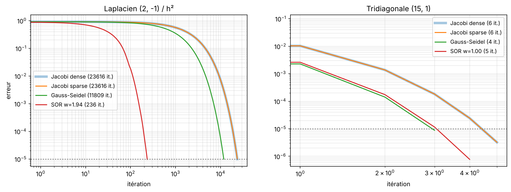

# Résolution de grands systèmes linéaires : Jacobi, Gauss-Seidel, SOR

Comparaison des méthodes itératives classiques pour résoudre $Ax = b$ quand la matrice est grande et creuse.

<p align="center"></p>

## Objectif

Étudier quand et à quelle vitesse les méthodes de Jacobi, Gauss-Seidel et SOR convergent, et mesurer ce que change le stockage de la matrice (dense ou creux). Projet réalisé à Polytech Nice Sophia.

## Démarche

- Implémentation de Jacobi (versions dense et creuse au format CSR), Gauss-Seidel et SOR.
- Étude de la convergence de Jacobi sur trois familles de matrices, en reliant dominance diagonale et rayon spectral.
- Mesure des temps de calcul dense / creux selon la taille et la densité de la matrice.
- Comparaison de Jacobi et Gauss-Seidel sur des matrices tridiagonales et sur le laplacien 1D.
- Recherche du paramètre de relaxation optimal de SOR et comparaison à la formule théorique.

## Résultats

- La dominance diagonale n'est qu'une condition suffisante : c'est le rayon spectral qui décide de la convergence.
- Sur une matrice très creuse, le format CSR rend Jacobi jusqu'à 200 fois plus rapide (matrice flèche de taille 3 000) ; sur une matrice presque pleine, le dense reste meilleur.
- Gauss-Seidel fait deux fois moins d'itérations que Jacobi sur une matrice tridiagonale peu dominante.
- Sur le laplacien (n = 100), SOR avec le bon paramètre converge en **236 itérations** contre 23 616 pour Jacobi.

## Outils

Python, NumPy, SciPy (matrices creuses), Matplotlib

## Utilisation

Le code et les explications sont dans [`systemes_lineaires.ipynb`](systemes_lineaires.ipynb). Le rapport du projet est dans `docs/`.

```bash
pip install -r requirements.txt
jupyter notebook systemes_lineaires.ipynb
```
